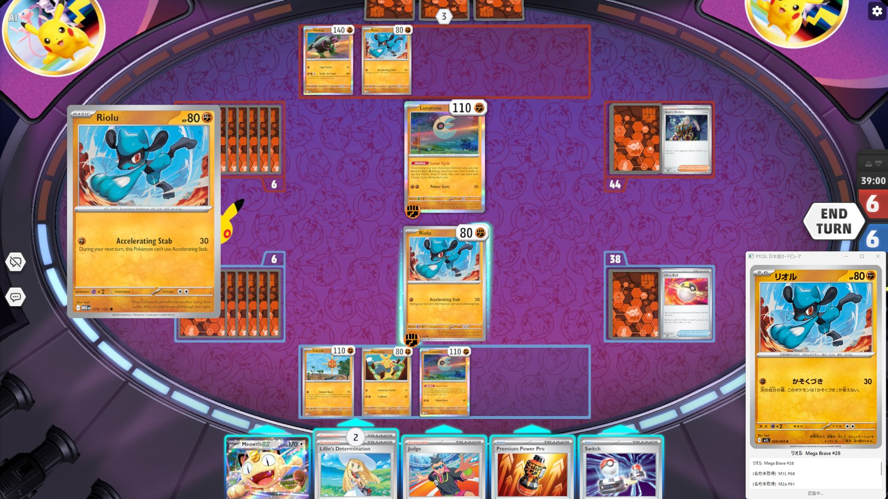

# ptcgl

Pokémon TCG Live（PTCGL）の画面に表示される英語カードを認識し、対応する日本語版ポケモンカード画像を表示する Windows デスクトップアプリです。



- ゲーム本体のファイル・メモリ・通信には一切触れず、画面キャプチャだけで動作します
- カード画像の出典は Limitless TCG（日本語画像は pokemon-card.com 由来）です。**個人利用・ローカルキャッシュのみ**を前提とし、取得した画像やアプリの再配布は行いません

## 必要環境
- Windows 10/11
- Python 3.12（開発時）。配布版（`dist/ptcgl`）は Python 同梱で、受け取る側のインストールは不要

## セットアップ
```powershell
py -3.12 -m venv .venv
.venv\Scripts\Activate.ps1
pip install -e ".[dev]"
```

## 起動
```powershell
python -m ptcgl                                   # GUI
python -m ptcgl identify --set SVI --number 1     # 英語カードを指定して日本語版を表示
python -m ptcgl -v identify --image shot.png      # スクリーンショットから検出→OCR→照合
python -m ptcgl windows                           # ウィンドウ一覧（矩形・DPI）
python -m ptcgl capture --window "TCG Live" --out shot.png
```

設定・キャッシュの保存先はユーザーごとのディレクトリです（`python -m ptcgl config-path` で表示）。

## 開発
```powershell
pytest                        # テスト
ruff check . ; ruff format .  # Lint / フォーマット
mypy src                      # 型チェック
pyinstaller packaging/ptcgl.spec   # 配布用ビルド（dist/ptcgl/ptcgl.exe）
```

精度の計測は `assets/samples/` にスクリーンショットと `labels.csv` を置いて
`python scripts/evaluate.py assets/samples --out docs/validation-results.md` を実行します。

遊ぶ人向けの使い方（準備・画面の見方・困ったとき）は [docs/usage.md](docs/usage.md) の 1〜6 章、開発者向けは同 7 章以降、要件は [docs/spec.md](docs/spec.md)、設計は [docs/architecture.md](docs/architecture.md) を参照してください。
