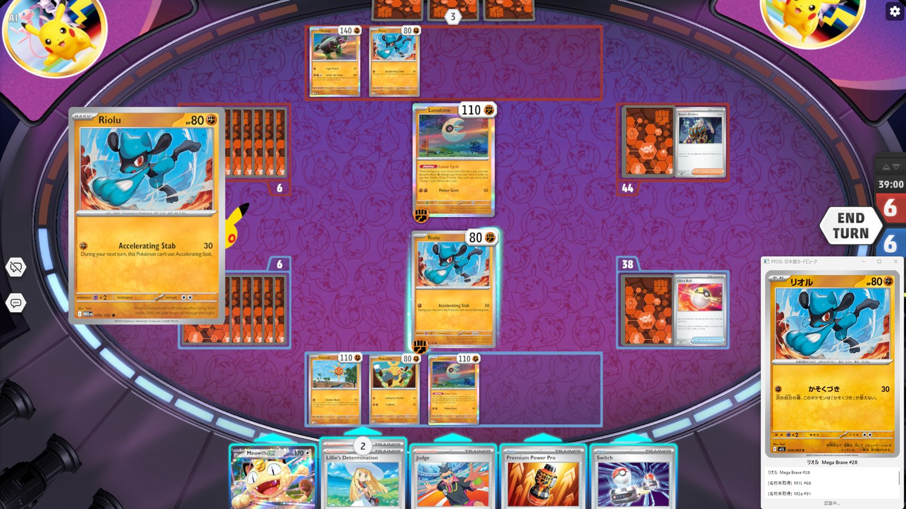
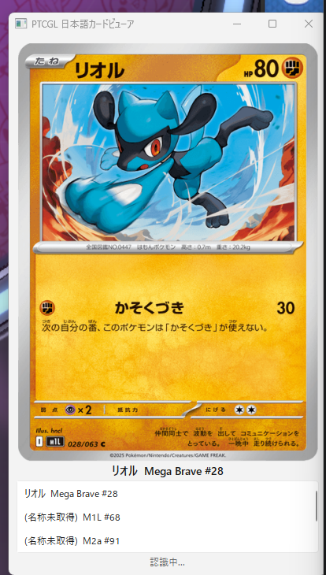

# PTCGL 日本語カードビューア 使い方

このアプリは、Pokémon TCG Live（PTCGL）で表示している **英語のカード** を読み取り、同じカードの **日本語版の画像** を小さなウィンドウに表示します。
英語が読めなくても、カードの効果を日本語で確認しながら対戦できます。

- **遊ぶ人** は 1〜6 章を読んでください。パソコンの専門知識は不要です。
- **自分で exe を作る人・開発者** は 7 章以降も読んでください。

---

## 1. できること・できないこと

**できること**

- PTCGL でカードを拡大表示すると、約 1 秒で日本語版の画像が出ます
- 日本語版が複数あるカード（再録や別イラスト）は、一覧から好きな方を選べます。選んだものは記憶され、次回から自動でそれが出ます

**できないこと・注意**

- ゲームの操作や改変は一切しません。画面を「見る」だけで、ゲーム本体のファイルや通信には触れません
- 基本エネルギーはまだ認識できません
- カード情報と日本語画像はインターネットから取得します（出典: Limitless TCG。日本語画像は pokemon-card.com 由来）。取得した画像は **個人利用のみ** で、他の人に配布しないでください（アプリ本体にカード画像は含まれていません）

---

## 2. はじめる前に（準備）

**必要なもの**

- Windows 10 または 11 のパソコン
- PTCGL（インストール済みで、対戦できる状態）
- インターネット接続（初めて見るカードの情報を取りに行くため）

**ダウンロード**

Python などを別途インストールする必要はありません。

1. ブラウザで配布ページ <https://github.com/willcom1992/ptcgl/releases> を開きます。
2. いちばん上にある最新版の「Assets」を開き、`ptcgl-windows.zip` をクリックしてダウンロードします。
3. ダウンロードした zip を右クリック →「すべて展開」を押します。`ptcgl` という名前のフォルダができ、中に `ptcgl.exe` が入っています。

zip は数百 MB あります（文字認識のモデルと実行環境が入っているため）。
開発者や、自分でソースコードから exe を作りたい人は 7 章を参照してください。

**置き方**

1. 展開してできた `ptcgl` フォルダをそのまま好きな場所に置きます（デスクトップやドキュメントなど）。
   フォルダの中の他のファイルも動作に必要です。`ptcgl.exe` だけを別の場所にコピーしないでください。
2. 毎回フォルダを開くのが面倒なら、`ptcgl.exe` を右クリック →「送る」→「デスクトップ（ショートカットを作成）」でショートカットを作れます。
3. 新しい版に更新するときは、古い `ptcgl` フォルダを削除して新しいものに置き換えます。設定やカード情報は別の場所（6 章）に保存されているので消えません。

**初回起動時の警告について**

- 「Windows によって PC が保護されました」という青い画面が出ることがあります。これは署名のないアプリに対する標準の警告です。「詳細情報」→「実行」を押すと起動できます。
- ウイルス対策ソフトが反応した場合は、配布元に確認したうえで `ptcgl` フォルダを除外に追加してください。

---

## 3. 使い方

### 基本の流れ

1. PTCGL を起動します。
2. `ptcgl.exe` をダブルクリックします。「PTCGL 日本語カードビューア」という小さなウィンドウが開きます。
3. ウィンドウ下部の文字が「PTCGL のウィンドウを探しています...」から「監視中」に変われば準備完了です。
4. PTCGL でカードを拡大表示します（手札のカードにマウスを乗せる、場のポケモンをクリックする、など）。
5. 約 1 秒で日本語版の画像が表示されます。
6. 終わるときはウィンドウの「×」を押します（`Ctrl+Q` でも終了できます）。

PTCGL で手札のリオルを拡大すると、右端のビューアに日本語版のリオルが出ている様子です。



補足:

- 起動の順番は逆でも構いません。あとから PTCGL を立ち上げれば自動で見つけます。
- ウィンドウは PTCGL の上に重ねて置いても構いません。常に手前に表示され、認識の邪魔にもなりません。
- このウィンドウは配信や画面共有、スクリーンショットには写りません（わざとそうしています）。写したい場合は 8 章の設定を変えてください。

### 画面の見方



上から順に次のものが並びます。

1. **日本語版カードの画像** — ウィンドウを広げると画像も大きくなります
2. **カード名** — 日本語名と、収録セット・番号（例: リオル Mega Brave #28）
3. **オレンジ色の文字** — 確認が必要なときだけ出ます（下の「別イラスト（要確認）」を参照）。上の例では出ていません
4. **候補一覧** — 同じカードの日本語版が複数あるときだけ出ます。クリックで切り替え
5. **状態行** — いちばん下の灰色の文字。今なにをしているか（上の例では「認識中...」）

**状態行（いちばん下の灰色の文字）の意味**

| 表示 | 意味 |
| --- | --- |
| PTCGL のウィンドウを探しています... | PTCGL を探しています。PTCGL が起動していれば数秒で「監視中」に変わります |
| 監視中 | 準備完了。カードを拡大すれば認識します |
| 認識中... | 画面が変わったのを検知して、カードを読み取っています |
| カードを特定できません | 今の画面にカードが見つかりません。直前の画像はそのまま残ります。盤面を眺めているだけのときに出るのは正常です |
| PTCGL が最小化されています | PTCGL を画面に出してください |
| 一時停止中（Ctrl+R で再開） | 自分で止めた状態です。`Ctrl+R` で再開します |

**オレンジ色の文字「別イラスト（要確認）」**

同じ絵柄の日本語版が見つからなかったため、別の絵の日本語版を表示しています。カードの効果は同じです。
候補一覧に正しい絵柄があればクリックしてください。選んだものは記憶され、次回からそれが出ます。

**候補一覧**

同じカードの日本語版が複数ある場合（再録、特別なイラストなど）に表示されます。クリックすると画像が切り替わり、その選択が記憶されます。

### キー操作

| キー | 動作 |
| --- | --- |
| `Ctrl+R` | 認識を一時停止 / 再開 |
| `Ctrl+T` | 「常に手前に表示」のオン / オフ |
| `Ctrl+Q` | 終了 |

ウィンドウの位置と大きさは記憶され、次回も同じ場所に開きます。

---

## 4. 認識できる画面・できない画面

| PTCGL での操作 | 認識 | かかる時間の目安 |
| --- | --- | --- |
| 手札のカードにマウスを乗せる（カード全体が大きく出る） | ◎ | 約 1 秒 |
| トラッシュ（捨て札）の一覧でカードを選ぶ | ◎ | 約 1 秒 |
| カードを場に出した直後の拡大表示 | ◎ | 約 1 秒 |
| バトル場のポケモンを選ぶ（右側に情報パネルが出る画面） | ◎ | 約 1 秒 |
| 対戦中に自分・相手のポケモンを選ぶ（名前バー・大きな HP・ワザ説明が重なる画面） | ○ | 3〜5 秒。カード番号が隠れるため名前とワザから探します。同じカードの別の印刷が出ることがあります |
| 基本エネルギーの拡大 | × | 未対応 |
| 何も拡大していない盤面 | — | 「カードを特定できません」と出ます。間違ったカードは出しません |

- 初めて見るカードは、上の時間に加えてインターネットからの取得に 1〜3 秒かかります。2 回目以降はすぐ出ます。
- 検証したのは WQHD（2560x1440）のウィンドウモードだけです。他の解像度や拡大率ではうまく認識できないことがあります。その場合は 6 章の方法で報告してください。

---

## 5. 困ったとき

| 症状 | 確認すること・対処 |
| --- | --- |
| 「PTCGL のウィンドウが見つかりません」のまま変わらない | PTCGL を起動していますか？ 起動しているのに出続ける場合は、PTCGL の更新でウィンドウ名が変わった可能性があります。配布元に相談してください（開発者は 8 章の設定を参照） |
| 「監視中」なのにカードを拡大しても反応しない | PTCGL が最小化されていたり、他のウィンドウの後ろに隠れていませんか？ それでも反応しないときは `Ctrl+R` を 2 回押してください（一時停止 → 再開でやり直します） |
| カード名（英語）だけ出て画像が出ない | 日本語画像のダウンロードに失敗しています。インターネット接続を確認し、もう一度カードを拡大してください |
| 「対応する日本語版が見つかりません」 | そのカードの日本語版がデータに登録されていません（日本未発売など）。対処はありません |
| 違う絵柄・違う印刷のカードが出る | 候補一覧から正しいものをクリックしてください。次回からそれが出ます |
| 認識に時間がかかる | パソコンが重い状態（PTCGL 以外の重いソフト、ゲーム内の演出中）だと遅くなります。タスクバーに古い `ptcgl` が残っていないかも確認し、残っていれば閉じてください |
| 配信や画面共有に写らない | 仕様です。写したい場合は 8 章の `overlay.exclude_from_capture` を変えてください |
| アプリが固まった・勝手に閉じた | もう一度 `ptcgl.exe` を起動してください。繰り返す場合は 6 章のログを添えて報告してください |
| 最初からやり直したい | 6 章のフォルダにある `cache` フォルダを削除すると、カード情報を取り直します。`config.json` を削除するとウィンドウの位置などの設定が初期化されます |

---

## 6. うまくいかないときの報告のしかた

アプリの動作記録は、次のフォルダに保存されています。

1. エクスプローラーを開き、上のアドレス欄に `%LOCALAPPDATA%\ptcgl` と入力して Enter を押します。
2. 次のファイルがあります。

| ファイル・フォルダ | 内容 | 削除してよい？ |
| --- | --- | --- |
| `ptcgl.log` | 動作の記録（いつ何を認識し、なぜ失敗したか） | ○ |
| `config.json` | 設定（ウィンドウの位置など） | ○（初期化される） |
| `cache\` | インターネットから取得したカード情報と画像 | ○（取り直す） |
| `mapping.sqlite3` | 候補一覧で選んだ記憶 | ○（記憶が消える） |

報告するときは、`ptcgl.log` と、うまくいかなかったときの **PTCGL 画面のスクリーンショット**（`Win + Shift + S` または `PrintScreen`）を添えてください。
画面の状態行には短い言葉しか出ませんが、ログには詳しい理由が残っています。

---

## 7. 開発者向け: セットアップと exe の作成

### A. Python で動かす（開発環境）

1. Python 3.12 を入れる（`winget install Python.Python.3.12` または python.org）。
2. リポジトリ直下で仮想環境を作り、依存を入れる。

```powershell
py -3.12 -m venv .venv
.venv\Scripts\Activate.ps1
pip install -e ".[dev]"
```

3. 動作確認（ネットワークが必要）。

```powershell
python -m ptcgl identify --set SVI --number 1
```

「クヌギダマ（バイオレットex #1）」の画像がウィンドウに出れば成功です。

### B. 配布用の exe を作る（受け取る側は Python 不要）

```powershell
pyinstaller packaging\ptcgl.spec
```

`dist\ptcgl\ptcgl.exe` が生成されます。`dist\ptcgl` フォルダごと別の PC にコピーして使えます（Python や OCR モデルは同梱済み）。
以下のコマンド例の `python -m ptcgl` は `ptcgl.exe` に読み替えてください。
exe はコンソールウィンドウを開きません。動作ログは 6 章の `ptcgl.log` に残ります（CLI サブコマンドの結果を画面で見たいときは `python -m ptcgl` を使ってください）。

遊ぶ人に配るときは、`dist\ptcgl` を zip にして GitHub の Releases に添付します（2 章のダウンロード手順はこの名前を前提にしています）。

```powershell
Compress-Archive -Path dist\ptcgl -DestinationPath ptcgl-windows.zip
gh release create v0.1.0 ptcgl-windows.zip --title "v0.1.0" --notes "変更点"
```

> 注意: `dist\ptcgl` は約 350 MB あります。zip にはキャッシュ済みのカード画像を含めないでください（画像は個人利用のみ。ビルド直後の `dist\ptcgl` には含まれていません）。

---

## 8. 開発者向け: コマンドラインと設定

### 8-1. 常駐モード（引数なし）

PTCGL を起動してから、引数なしで実行すると 3 章の常駐モードになります。

```powershell
python -m ptcgl
```

- 画面が変化すると即座に「認識中...」になり、0.5〜1 秒ほどで日本語版の画像が表示されます。同じカードが続けて認識されても表示は変わりません。
- 表示ウィンドウは画面キャプチャから除外されるので、PTCGL に重ねても認識の邪魔になりません（この設定のため、スクリーンショットや画面共有にも写りません）。
- 認識時間の目安（WQHD、開発機）: 番号が見える表示は 0.5〜1 秒。番号が隠れる「対戦中の詳細表示」は名前検索に回るため 3〜5 秒。初めて見るカードはさらに Limitless の取得分（1〜3 秒）が加わります。同じカードを続けて認識したときは照合結果を再利用します。
- 演出で画面が動き続けている間に認識が失敗すると、試行間隔を自動で延ばします（画面が止まるか、カードが見つかれば元に戻ります）。止まった画面での失敗が続いた場合も、次の変化から最大 2 秒だけ待ってから試します。

### 8-2. セットコードと番号で日本語版を表示する（OCR なし）

カードの左下に印字されている `MEG EN 076/132` のうち、セットコード `MEG` と番号 `76` を指定します。

```powershell
python -m ptcgl identify --set MEG --number 76
```

- 同じイラストの日本語版が見つかれば自動で表示されます。
- 見つからない場合は「別イラスト（要確認）」として候補を表示します。候補一覧からクリックで切り替えられます。
- 対応する日本語版が無い場合は「対応する日本語版が見つかりません」と表示します。

### 8-3. スクリーンショットから認識する

PTCGL でカードを拡大表示した状態の画面を PNG で保存し、そのファイルを渡します。

```powershell
python -m ptcgl identify --image "C:\path\to\screenshot.png"
```

画面全体のスクリーンショットで構いません。拡大表示されたカードの位置は自動で推定します。
認識の内訳（OCR の読み取り行、推定した領域、照合理由）を見るには `-v` を **サブコマンドの前** に付けます。

```powershell
python -m ptcgl -v identify --image shot.png --no-gui
```

### 8-4. PTCGL のウィンドウを直接キャプチャする

```powershell
python -m ptcgl windows                                  # ウィンドウ一覧（矩形・DPI を確認）
python -m ptcgl capture --window "TCG Live" --out shot.png
python -m ptcgl identify --image shot.png
```

`--window` はウィンドウタイトルの正規表現です。省略すると設定の `target_window.title_pattern` を使います。

### 8-5. 認識方式の内訳

| 画面 | 認識方法 |
| --- | --- |
| フルカード表示・バトル場の詳細表示 | 印字された `セットコード EN 番号/分母` を OCR で読む |
| 対戦中の詳細表示 | 番号が隠れるため、名前・HP・ワザ名で Limitless を検索。同じカードの別印刷が選ばれることがあり、絵柄は未確認扱い |
| 基本エネルギー | 未対応 |
| 拡大していない盤面 | 「見つかりません」（誤ったカードは出さない） |

開発機（WQHD 2560x1440、ウィンドウモード）で 14 枚を検証した結果は [validation-results.md](validation-results.md) を参照してください。

### 8-6. 設定ファイル

保存場所と現在の内容は次のコマンドで確認できます。

```powershell
python -m ptcgl config-path
```

通常は `C:\Users\<ユーザー名>\AppData\Local\ptcgl\config.json` です。主な項目:

| 項目 | 意味 | 既定 |
| --- | --- | --- |
| `target_window.title_pattern` | PTCGL ウィンドウを探すタイトルの正規表現 | `Pok[eé]mon TCG Live` |
| `target_window.process_name` | 同プロセス名 | `Pokemon TCG Live.exe` |
| `capture.interval_ms` | 常駐モードで画面を確認する間隔（ミリ秒）。短いほど反応が早い | `250` |
| `capture.change_threshold` | この値以上画面が動いたら認識対象にする（縮小グレースケールの平均差分、0〜255） | `4.0` |
| `capture.stable_threshold` | 直前の確認からの差分がこの値未満なら「静止した」とみなして認識する | `1.5` |
| `capture.detection_mode` | `auto`（OCR で領域を推定）か `manual`（固定領域） | `auto` |
| `capture.card_region_ratio` | `manual` のときの領域。対象ウィンドウに対する比率 `[rx, ry, rw, rh]` | なし |
| `overlay.always_on_top` | 表示ウィンドウを最前面にする | `true` |
| `overlay.exclude_from_capture` | 表示ウィンドウを画面キャプチャから除外する（`false` にすると画面共有に写るが、PTCGL に重ねると認識の邪魔になる） | `true` |
| `http_min_interval` | Limitless へのアクセス間隔（秒）。短くしないでください | `1.0` |
| `ocr_threads` | OCR に使う CPU スレッド数。`0` なら自動（論理コアの半分、2〜4）。全コアを使うと逆に遅くなる | `0` |

キャッシュ・ログ・対応表の場所は 6 章を参照してください。`ptcgl.log` には 1 回ごとの認識時間と経路、照合の理由、失敗の原因が残ります。

### 8-7. 開発者向けトラブルシューティング

| 症状 | 対処 |
| --- | --- |
| 「PTCGL のウィンドウが見つかりません」 | タイトルが変わった場合は `target_window.title_pattern` を直す |
| 常駐モードで反応しない | 画面の動きが `change_threshold` 未満だと認識しない。`Ctrl+R` を 2 回押すと履歴を捨て、次の変化からすぐ認識する |
| 常駐モードで認識が走りすぎる・重い | `capture.change_threshold` を大きく（例 `8.0`）、`capture.interval_ms` を長く（例 `2000`）する。古い版を起動したままにしない（CPU を占有し続ける） |
| 認識が遅い | `ptcgl.log` の「認識 … timings=」でどの段階に時間がかかっているか確認。`ocr_threads` を `2`〜`4` の範囲で変えて試す。PTCGL 自体の負荷が高いと OCR も遅くなる |
| 「拡大表示されたカードが見つかりません」 | 基本エネルギーは未対応。`-v` で OCR 行を確認し、番号 `NNN/TTT` が読めているか見る |
| 「分母 182 の候補とカード名が一致しません」 | 番号の分母が複数セットで同じ（DRI/PAR など）場合に名前で絞り込めなかった。`--set` と `--number` を直接指定する |
| 「検索で見つかりません」 | 対戦中の詳細表示で名前の OCR が崩れている。フルカード表示（手札ホバー等）で試す |
| 文字化け | コンソールの文字コードが cp932 のときは `set PYTHONIOENCODING=utf-8` を設定するか、出力をファイルにリダイレクトする |

---

## 9. 開発者向け: 精度の計測

1. `assets\samples\` にスクリーンショット（PNG）を置く。
2. `assets\samples\labels.csv` に 1 行ずつ正解を書く。

```csv
file,en_set,en_number,jp_set,jp_number,resolution,scale,monitors,mode,card_region,note
shot06_173408.png,MEG,76,,,2560x1440,100%,1,window,,手札ホバーのフルカード Riolu 076/132
```

   - `en_set` / `en_number` が空の行は負例（カードが無い画面）として扱います。
   - `jp_set` / `jp_number` は省略可。書けば日本語照合も採点します。
3. 実行する。

```powershell
python scripts\evaluate.py assets\samples --out docs\validation-results.md
```

検出率・英語カード特定率・所要時間の表と、失敗例の OCR 生テキストが出力されます。評価は使い捨ての対応表で行うため、普段使いの記憶は汚しません。

カード領域検出の方式を比較したいときは `python scripts\detect_spike.py assets\samples` を使います（検出結果を描画した画像を `.cache\detect\` に出力）。

---

## 10. 今後（Phase 1 の残り）

- 「対戦中の詳細表示」（番号が隠れる画面）の高速化
- 初回起動時のウィンドウ選択と領域指定のダイアログ、モニター構成変更時の再設定
- フルHD / 4K、表示倍率 125〜200%、2 枚モニターでの検証
- 対戦中の詳細表示での絵柄一致（英語画像との画像比較）、基本エネルギー対応
